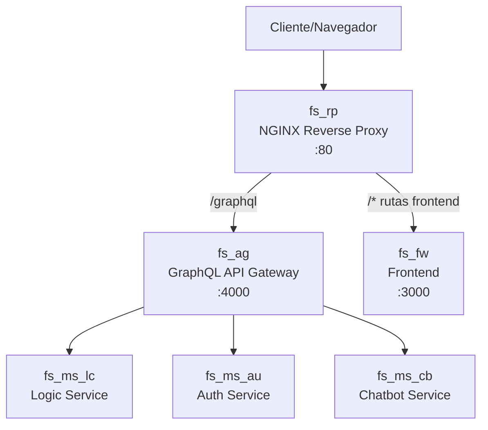

# FullStyle NGINX Reverse Proxy

Este repositorio proporciona un servidor NGINX como reverse proxy para la API Gateway GraphQL de FullStyle, permitiendo exponer de manera segura los servicios a las aplicaciones frontend (web y mobile) .

## Descripción general

El reverse proxy:

- Enruta las peticiones de API GraphQL al API Gateway
- Expone el frontend a través de la ruta raíz (`/`)
- Mantiene rutas específicas como `/login`, `/register`, etc.
- Gestiona los archivos estáticos de Next.js (`/_next/`)
- Proporciona manejo de errores y páginas 404/500

## Arquitectura



## Requisitos previos

- Docker y Docker Compose para la implementación local
- Acceso a los servicios de FullStyle (API Gateway, Frontend)

## Archivos de configuración

- `nginx.conf` - Configuración de NGINX para entorno de desarrollo
- `Dockerfile` - Configuración para construir la imagen Docker del reverse proxy

## Implementación con Docker Compose

### 1. Añadir al docker-compose.yaml

El reverse proxy se integra en el archivo `docker-compose.yaml` del orquestador local como un servicio adicional:

```yaml
services:
  # Otros servicios...

  fs_rp:
    build: ./FullStyle-ReverseProxy
    ports:
      - "80:80"
    volumes:
      - ./FullStyle-ReverseProxy/nginx.conf:/etc/nginx/nginx.conf:ro
    depends_on:
      - fs_ag
      - fs_fw
    restart: unless-stopped
```

### 2. Configuración de NGINX

El archivo `nginx.conf` contiene:

```nginx
worker_processes 1;
events {
    worker_connections 256;  # Adecuado para desarrollo local
}

http {
    # Configuración básica...

    # Upstreams
    upstream apollo_gateway {
        server fs_ag:4000;  # Nombre del servicio API Gateway en Docker Compose
    }

    upstream frontend {
        server fs_fw:3000;  # Nombre del servicio Frontend en Docker Compose
    }

    server {
        # Configuración de rutas...
    }
}
```

## Cómo funciona con Docker Compose

1. El contenedor `fs_rp` se construye a partir del `Dockerfile` en `FullStyle-ReverseProxy`
2. El archivo `nginx.conf` se monta como volumen para facilitar modificaciones sin reconstruir la imagen
3. El proxy depende de los servicios `fs_ag` (API Gateway) y `fs_fw` (Frontend)
4. Se exponen los puertos 80 para acceso desde el navegador

## Rutas configuradas

- `/`: Muestra el frontend principal
- `/graphql`: Redirige a la API GraphQL
- `/_next/`: Gestiona los archivos estáticos de Next.js
- `/login`, `/register`, etc.: Todas las rutas de frontend funcionan correctamente

## Pruebas

Tras iniciar los servicios con `docker-compose up -d`, prueba:

1. Acceder a la interfaz principal: http://localhost/
2. Acceder a la API GraphQL: http://localhost/graphql
3. Navegar entre rutas como `/login`, `/register`, etc.

## Solución de problemas comunes

- **Página de bienvenida de NGINX**: Si ves la página de bienvenida predeterminada, revisa que el frontend esté funcionando correctamente y que las rutas en `nginx.conf` sean correctas.
- **Error 502 Bad Gateway**: Verifica que los servicios upstream estén funcionando y accesibles.
- **Estilos no cargan**: Asegúrate que las rutas `/_next/` están correctamente configuradas.
- **Redirecciones no deseadas**: La configuración incluye un bloque para evitar redirecciones a `/app`.

## Próximos pasos

Para añadir más servicios o rutas, agrega bloques adicionales de location al archivo de configuración:

```nginx
location /api/nuevo-servicio {
    proxy_pass http://nuevo-servicio:8080/;
    # ... configuración de proxy ...
}
```
