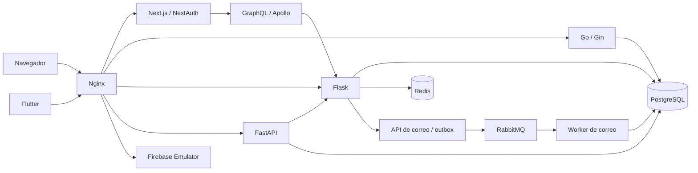

# FullStyle

Plataforma para gestionar sedes, servicios, profesionales y reservas de barberías y salones. Integra una aplicación web, un cliente Flutter y servicios de negocio, identidad, chatbot y correo.

Este monorepo reúne el proyecto académico del equipo **Full-Serios** y su modernización incremental. Diego Nicolás Ramírez mantiene esta presentación de portafolio; la procedencia y los colaboradores del proyecto original se registran en [AUTHORS.md](AUTHORS.md) y [docs/provenance.json](docs/provenance.json).

## Ejecutar la demo

Requisitos: Git y Docker con Compose v2, motor Linux y recursos disponibles para doce contenedores. La primera compilación descarga las imágenes y dependencias fijadas en sus locks.

```bash
git clone https://github.com/dieramirezma/fullstyle.git
cd fullstyle
docker compose up --build -d --wait --wait-timeout 240
```

Abrir **http://localhost:38080**. El registro permite crear una cuenta de prueba propia; no se publica ninguna cuenta administrativa. Las páginas `/operations` y `/chatbot` requieren iniciar sesión.

La demo usa datos sintéticos, Firebase Emulator y adaptadores locales. No requiere archivos `.env` ni cuentas de proveedores. Pagos, reembolsos, suscripciones, correo y respuestas del chatbot tienen un alcance de demostración explícito; no producen efectos comerciales. La configuración de Compose se limita a este entorno local.

```bash
docker compose ps
docker compose logs --tail=100 backend
docker compose down
```

`down` conserva los volúmenes de la demo. [Operación, puertos y limpieza](docs/local-demo.md).

## Arquitectura



| Carpeta | Responsabilidad |
| --- | --- |
| `FullStyle-Frontend` | Web Next.js, sesiones y panel de operaciones |
| `FullStyle-App` | Cliente Flutter, validado con análisis, tests y compilación web |
| `FullStyle-Backend` | Recursos, autorización, reservas y autoridad financiera sintética |
| `FullStyle-Backend-Go` | Adaptador de autenticación compatible con la política SQL |
| `FullStyle-API-Gateway` | Contratos GraphQL |
| `FullStyle-Chatbot` | Conversaciones y operaciones autorizadas entre réplicas |
| `FullStyle-Email-Service` | Outbox, reentrega y deduplicación de correo |
| `FullStyle-ReverseProxy` | Entrada HTTP y enrutamiento |
| `docker`, `scripts`, `tests` | Builds reproducibles, operación y validación del sistema |

Cada servicio conserva su proceso y su Dockerfile. Las carpetas contienen código versionado directamente: no es necesario clonar repositorios adicionales ni inicializar submódulos.

## Modernización

El trabajo conserva los servicios y los contratos de transición, y añade autorización de recursos, sesiones revocables y MFA recuperable, reservas bajo bloqueo SQL, caché prescindible, deduplicación financiera, correo durable, historial compartido y migraciones explícitas.

La importación procede de una copia con seis fases y un cierre complementario verificados localmente. Sus resultados históricos incluyen 47 casos pytest con PostgreSQL real, 19 regresiones de seguridad, 17 contratos HTTP y pruebas de fallos, concurrencia y navegador. La validación del monorepo se registra por separado: [plan y checklist](docs/architecture-review/refactoring-plan.md), [comparación y publicación](docs/monorepo-migration.md).

## Calidad y pruebas

Para contribuir: Python 3.13, Node 22.23.4, pnpm 10.8.1 y Flutter 3.32.2. Go y el resto de runtimes se construyen en Docker.

```bash
python scripts/bootstrap.py
# Linux/macOS
.venv/bin/python scripts/ci.py
# Windows PowerShell
.\.venv\Scripts\python.exe scripts/ci.py
```

La pipeline aplica Ruff, mypy al keyring, ESLint, Prettier, TypeScript, gofmt, go vet y análisis Dart/Flutter. Comprueba efectos persistentes, acceso ajeno, reservas concurrentes, repetición de eventos, revocación, recuperación y restauración de respaldos; las mutaciones deben demostrar que las pruebas detectan regresiones. [Comandos, alcance y límites](docs/testing.md).

## Procedencia y alcance

Se publica una importación del estado de trabajo modernizado, sin incorporar objetos Git históricos. Los commits de referencia, colaboradores y hashes de los archivos importados están en [provenance.json](docs/provenance.json). Los repositorios y la copia de validación anteriores se conservan por separado. Se mantienen las licencias existentes por componente; [NOTICE.md](NOTICE.md) describe su alcance.

Esta entrega es una demo local de portafolio. No certifica un despliegue productivo ni la integración comercial con proveedores. [Política de seguridad](SECURITY.md).
