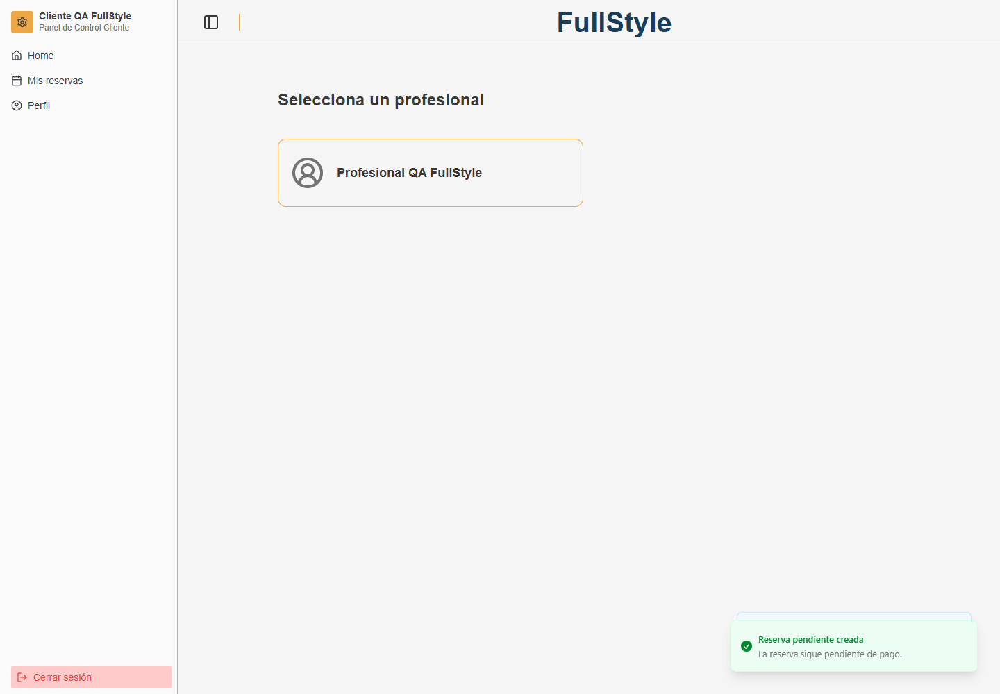
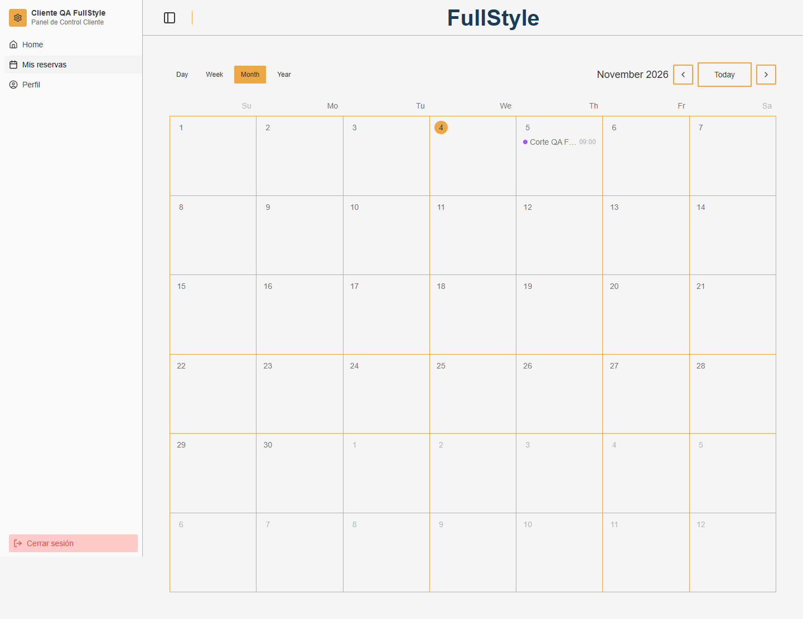
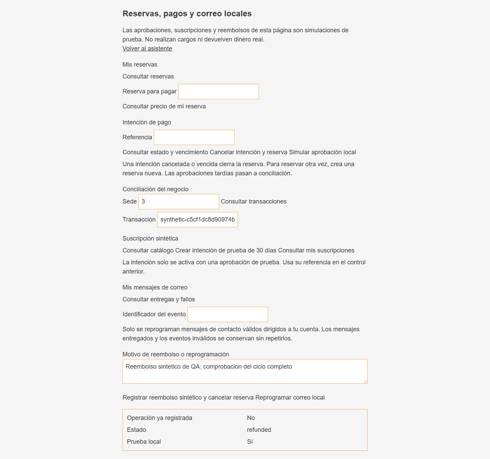
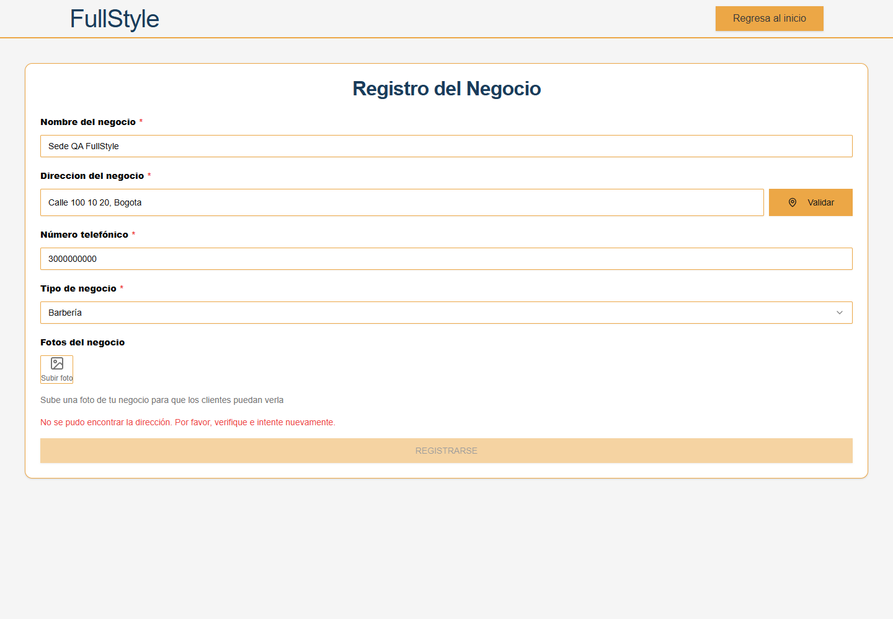
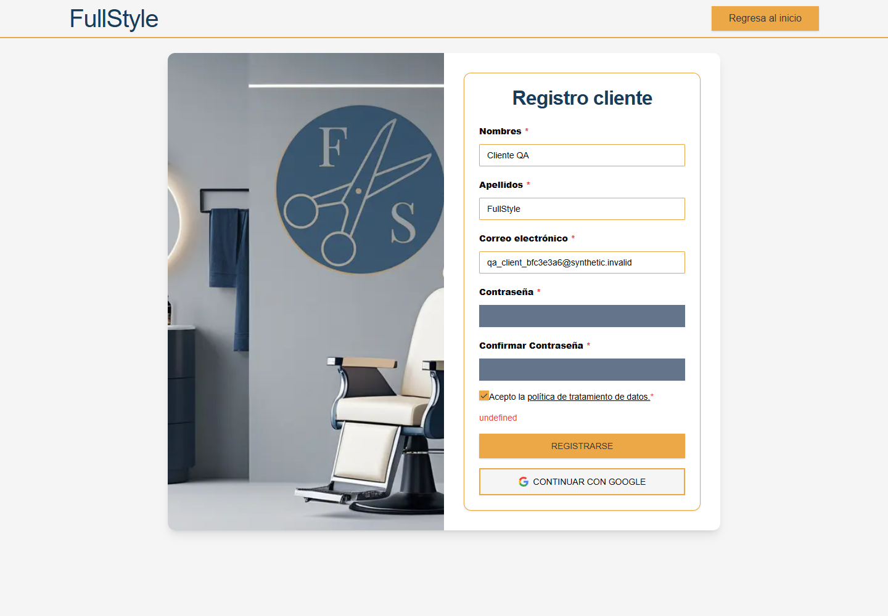

# QA funcional de FullStyle — 2026-11-04

**Estado: parcialmente funcional.** El ciclo cliente de reserva, pago simulado, conciliación y reembolso se completó desde la interfaz con datos sintéticos precargados. El alta autónoma de un negocio queda bloqueada por la geocodificación local desactivada. Se reproducen además tres fallos de interfaz y se registran observaciones adicionales. No se declara aprobada toda la aplicación por haber pasado CI.

**40 comprobaciones: 36 PASA, 3 FALLA, 1 BLOQUEADO; 41 capturas.** Los conteos describen este recorrido seleccionado, no un porcentaje de cobertura del producto. [Resultados y hashes de capturas](results.json).

## Entorno y alcance

| Dato | Valor |
| --- | --- |
| Fecha | 2026-11-04, America/Bogota; cierre UTC `2026-11-05T01:58:55.093307+00:00` |
| Aplicación | `http://localhost:38080`, proyecto Docker `fullstyle-portfolio` |
| Código evaluado | `8fe5e16c97894ac117b1f536b68e7fc7a7fb010a` |
| Fingerprint | `3b464616a52b75a9af61d109c5ad776739f1e8f9819cc5b98563fd9ae2c5f590` |
| Navegador | Microsoft Edge headless, perfiles independientes y nuevos, sin extensiones de usuario |
| Viewports | Escritorio 1440 × 1000; móvil simulado 390 × 844 |
| Datos | Dos cuentas creadas por UI, suscripción de prueba y una oferta sintética precargada |
| Integridad | Original: 720 archivos y nueve estados Git intactos; fuente modernizada sin cambios |

Se utilizaron clicks, formularios, navegación y controles reales de la web mediante Playwright. Se observaron respuestas HTTP y errores del navegador para diagnosticar el resultado; no se sustituyeron las respuestas del servidor ni se alteró el código de producto durante el QA. Las capturas de formularios enmascaran las contraseñas con bloques grises.

## Recorridos comprobados

- Registro de cliente y administrador desde sus formularios; validación de campos vacíos y rechazo de contraseña incorrecta.
- Login, perfil, cambio de contraseña, revocación de la sesión anterior, nuevo login y logout.
- Navegación de cliente y administrador, separación de roles y acceso móvil al calendario.
- Catálogo y agenda: selección de servicio, profesional y horario; reserva pendiente creada con HTTP 201 y visible en Mis reservas.
- Suscripción sintética activada desde botones; nueva sesión del administrador accede al dashboard.
- Cotización del servidor, intención de pago, aprobación simulada, conciliación y reembolso desde la UI. La reserva termina cancelada y conserva su registro.
- Chatbot: mensaje enviado con HTTP 200 y respuesta del adaptador local, que informa expresamente que no hay un LLM comercial conectado.

### Preparación de datos y estado final

Primero se probó una instalación sin oferta: los estados vacíos y errores quedaron capturados. Después del bloqueo de alta de negocio, se prepararon **sede 3, profesional 3, servicio 3 y disponibilidad semanal mediante ORM dentro del backend local**, con comprobación previa de aislamiento. Esto permitió probar la reserva desde el cliente y no constituye evidencia de que la creación del negocio funcione por interfaz.

La oferta de prueba tiene precio de 20.000 COP y duración de 30 minutos. La reserva `5` se creó por UI, se pagó y reembolsó exclusivamente con el simulador; su estado final observado es `cancelled`. Las cuentas, la suscripción sintética y la oferta permanecen en los volúmenes locales para revisión. **No se publican bases de datos, sesiones ni contraseñas.** Las credenciales están en el archivo local `.quality/qa/credentials.json`, excluido de Git.

## Hallazgos reproducibles

### F-01 — Bloqueo de alta de negocio en la demo local · P1 / entorno

**Caso QA-31.** Con administrador autenticado y suscripción sintética activa: abrir `/register/business`, completar nombre, dirección, teléfono y tipo de negocio; pulsar **Validar**. `/api/geocode` responde **503** porque el proveedor está desactivado y el registro queda deshabilitado. La pantalla indica dirección no encontrada, sin explicar la limitación del entorno.

Impacto: una persona que clona la demo no puede completar por sí sola el onboarding de una sede. Acción propuesta: proporcionar geocodificación ficticia o ingreso manual de coordenadas para el modo local y un mensaje explícito; mantener separados los proveedores reales. [Captura](screenshots/qa-31.png).

### F-02 — Selector de sitio vacío pese a existir una sede · P2

**Caso QA-40.** Con la oferta precargada: abrir `/customer`, pulsar **Filtros** y desplegar **Sitio**. El selector está vacío. La petición `GET /api/logic/site?service_id=` responde **400** por enviar un identificador numérico vacío.

Impacto: la búsqueda general muestra la oferta y permite reservar, pero el filtro de sitio no funciona. Acción propuesta: omitir el parámetro cuando no haya un servicio seleccionado y manejar errores de carga en el panel. [Captura](screenshots/qa-40.png).

### F-03 — Registro duplicado muestra `undefined` · P2

**Caso QA-14.** Usar el formulario de cliente con un correo ya registrado, el resto de campos válidos y políticas aceptadas. El servidor rechaza el duplicado; la interfaz muestra literalmente **`undefined`**.

Impacto: no se crea una cuenta duplicada, pero el usuario desconoce el motivo del rechazo. Acción propuesta: leer el mensaje del error GraphQL y proporcionar un fallback visible. [Captura](screenshots/qa-14.png).

### F-04 — Consulta vacía se presenta como error técnico · P3

**Caso QA-16, antes de precargar reservas.** Entrar a `/operations` con una cuenta nueva y pulsar **Consultar reservas**. La respuesta es **404** y se muestra **`Appointment not found`**. Tras crear una reserva, la misma consulta devuelve los datos correctamente.

Impacto: el usuario interpreta la ausencia normal de reservas como un fallo. Acción propuesta: convertir la respuesta vacía de transición en un estado de UI “Todavía no tienes reservas”, conservando el contrato backend mientras corresponda. [Captura](screenshots/qa-16.png).

## Observaciones adicionales

- **Perfil, React #418:** se reproduce un error de hidratación al abrir `/customer/profile` en un navegador sin extensiones. La pantalla se recupera y el cambio de contraseña funciona. Requiere depurar el HTML/SSR; no se cuenta como un flujo completo bloqueado. [Referencia del error](https://react.dev/errors/418).
- **Métricas tras reembolso:** después de cancelar la reserva mediante reembolso, el dashboard continúa mostrando **20.000 COP** en “Ingresos del mes” y una reserva histórica. El registro cancelado y el reembolso sí se confirman en operaciones. Falta aclarar si el indicador representa ingresos brutos: la pantalla no distingue reembolsos ni neto. Se requiere definir y etiquetar esa semántica antes de usarlo como informe contable. No se afirma que la conservación de la reserva histórica sea incorrecta. [Captura final](screenshots/qa-23.png).
- **Menú móvil:** al navegar a Mis reservas, el menú permanece abierto y tapa el contenido; se puede cerrar con Escape o el fondo. La navegación funciona y no se observa desbordamiento horizontal en 390 px. [Menú abierto](screenshots/qa-20-menu-open.png), [contenido](screenshots/qa-20.png).
- **Consola:** se observan promesas sin manejar ante 404 de catálogos vacíos y 400 del filtro; también un intento de cargar Google Maps con clave indefinida que la CSP local bloquea. No se debilitaron las protecciones para ocultar esos mensajes.

## Evidencia visual destacada

### Reserva creada desde la interfaz

### Reserva en el calendario

### Reembolso sintético

### Bloqueo del onboarding

### Registro duplicado

## Matriz de comprobaciones

“PASA” confirma el resultado descrito de ese caso; una página renderizada no acredita todo su CRUD. “BLOQUEADO” indica que no pudo completarse por una precondición del entorno. Los fallos de selectores o precondiciones del harness se corrigieron y conservaron por separado como diagnósticos privados; no se computan como defectos del producto ni como pruebas aprobadas sin repetición.

| Caso | Comprobación | Estado | Evidencia |
| --- | --- | --- | --- |
| QA-01 | Página inicial | **PASA** | [Captura](screenshots/qa-01.png) |
| QA-02 | Selección de registro | **PASA** | [Captura](screenshots/qa-02.png) |
| QA-03 | Formulario de cliente | **PASA** | [Captura](screenshots/qa-03.png) |
| QA-04 | Formulario de administrador | **PASA** | [Captura](screenshots/qa-04.png) |
| QA-05 | Acceso anonimo a planes | **PASA** | [Captura](screenshots/qa-05.png) |
| QA-06 | Validación de registro vacío | **PASA** | [Captura](screenshots/qa-06.png) |
| QA-07 | Registro de cliente desde la interfaz | **PASA** | [Captura](screenshots/qa-07.png) |
| QA-08 | Contraseña incorrecta | **PASA** | [Captura](screenshots/qa-08.png) |
| QA-09 | Login correcto y área de cliente | **PASA** | [Captura](screenshots/qa-09.png) |
| QA-10 | Perfil del cliente | **PASA** | [Captura](screenshots/qa-10.png) |
| QA-11 | Calendario de citas | **PASA** | [Captura](screenshots/qa-11.png) |
| QA-12 | Panel de operaciones | **PASA** | [Captura](screenshots/qa-12.png) |
| QA-13 | Interfaz de chatbot | **PASA** | [Captura](screenshots/qa-13.png) |
| QA-14 | Correo duplicado en registro | **FALLA** | [Captura](screenshots/qa-14.png) |
| QA-15 | Búsqueda y filtros sin catálogo | **PASA** | [Captura](screenshots/qa-15.png) |
| QA-16 | Consultar reservas y correo desde operaciones | **FALLA** | [Captura](screenshots/qa-16.png) |
| QA-17 | Mensaje e historial del chatbot | **PASA** | [Captura](screenshots/qa-17.png) |
| QA-18 | Cambio de contraseña desde perfil | **PASA** | [Captura](screenshots/qa-18.png) |
| QA-19 | Cerrar sesión y volver a entrar | **PASA** | [Captura](screenshots/qa-19.png) |
| QA-20 | Vista móvil y navegación lateral | **PASA** | [Captura](screenshots/qa-20.png) |
| QA-21 | Registro de administrador desde UI | **PASA** | [Captura](screenshots/qa-21.png) |
| QA-22 | Login de administrador y requisito de plan | **PASA** | [Captura](screenshots/qa-22.png) |
| QA-23 | Dashboard después del reembolso | **PASA** | [Captura](screenshots/qa-23.png) |
| QA-24 | Consulta de negocio precargado | **PASA** | [Captura](screenshots/qa-24.png) |
| QA-25 | Pantalla de empleados | **PASA** | [Captura](screenshots/qa-25.png) |
| QA-26 | Pantalla de servicios | **PASA** | [Captura](screenshots/qa-26.png) |
| QA-27 | Operaciones de administrador | **PASA** | [Captura](screenshots/qa-27.png) |
| QA-28 | Planes con sesión de administrador | **PASA** | [Captura](screenshots/qa-28.png) |
| QA-29 | Activación de suscripción sintética por UI | **PASA** | [Captura](screenshots/qa-29.png) |
| QA-30 | Nueva sesión de administrador con plan activo | **PASA** | [Captura](screenshots/qa-30.png) |
| QA-31 | Alta de negocio: validación de dirección | **BLOQUEADO** | [Captura](screenshots/qa-31.png) |
| QA-32 | Catálogo con datos sintéticos precargados | **PASA** | [Captura](screenshots/qa-32.png) |
| QA-33 | Seleccionar profesional y horario | **PASA** | [Captura](screenshots/qa-33.png) |
| QA-34 | Crear reserva desde la interfaz | **PASA** | [Captura](screenshots/qa-34.png) |
| QA-35 | Reserva visible en el calendario del cliente | **PASA** | [Captura](screenshots/qa-35.png) |
| QA-36 | Pago sintético de la reserva desde operaciones | **PASA** | [Captura](screenshots/qa-36.png) |
| QA-37 | Conciliación y reembolso sintético desde UI | **PASA** | [Captura](screenshots/qa-37.png) |
| QA-38 | Estado de reserva después del reembolso | **PASA** | [Captura](screenshots/qa-38.png) |
| QA-39 | Separación de rol cliente/administrador | **PASA** | [Captura](screenshots/qa-39.png) |
| QA-40 | Filtro de sedes con catálogo precargado | **FALLA** | [Captura](screenshots/qa-40.png) |

## Reproducir el recorrido con un checkout nuevo

1. Levantar la demo siguiendo el README principal. Crear por UI un cliente y un administrador con correo `qa_owner_*@synthetic.invalid` y datos ficticios.
2. Con el administrador, abrir `/operations`, consultar catálogo, crear la intención de suscripción y usar su referencia para simular la aprobación. Cerrar sesión e iniciar nuevamente.
3. Para reproducir QA-32 a QA-38 mientras el alta de negocio siga bloqueada, usar el [preparador de datos](setup-fixture.py) desde la raíz: `python docs/qa/2026-11-04/setup-fixture.py --owner-email qa_owner_ejemplo@synthetic.invalid`. Sin `--apply` solo describe la operación. Añadir `--apply` crea los registros sintéticos dentro del proyecto local validado y deja sus identificadores en `.quality/qa-reproduction-fixture.json`. Requiere un administrador sin sede y con suscripción de prueba activa; no modifica cuentas ni sedes existentes.
4. Entrar como cliente, seleccionar la oferta, profesional y un horario futuro; confirmar la reserva. En `/operations`, usar su ID para cotizar, crear intención y simular aprobación.
5. Con el propietario, conciliar por ID de sede, copiar la transacción y registrar reembolso sintético. Volver al cliente y consultar el estado cancelado.

Esta preparación replica la oferta usada por QA y no corrige ni acredita el onboarding de UI. La lógica de creación del fixture se ejecutó durante esta revisión; el wrapper público parametrizado se verificó también con análisis estático y modo descriptivo. No es necesario volver a crear los datos en la copia local ya evaluada.

## Pendiente de verificar

No se certifican: alta de sedes por UI mientras siga F-01; CRUD completo de empleados y servicios; subida de imágenes; OAuth Google real; entrega externa de correo; cobros, reembolsos o suscripciones comerciales; calidad de un LLM real; aplicación móvil nativa; otros navegadores ni auditoría integral de accesibilidad. Las pantallas de empleados/servicios sí se abrieron con datos, pero su render no se presenta como prueba de todas esas operaciones.

Las pruebas automatizadas anteriores de MFA, concurrencia, deduplicación y fallos siguen siendo evidencia adicional, separada de estas 40 comprobaciones de UI. [Validación Docker local](../../local-validation.json), [GitHub Actions aprobado para el código evaluado](https://github.com/dieramirezma/fullstyle/actions/runs/41947745113). El QA añade documentación y capturas; no modifica el código que pasó esos checks.

## Prioridad propuesta

1. Resolver el bloqueo F-01 mediante una alternativa local que permita completar el onboarding.
2. Corregir F-02 y F-03; repetir sus casos y el recorrido de reserva.
3. Mejorar F-04, depurar hidratación/errores sin manejar y aclarar las métricas de reembolsos.
4. Completar CRUD, uploads y la matriz de navegadores según el alcance de la siguiente entrega.

El estado actual permite una **demostración técnica guiada con datos precargados**. El onboarding autónomo de un negocio todavía requiere trabajo. No se aplicaron correcciones de producto durante esta revisión: el informe refleja los comportamientos observados.
